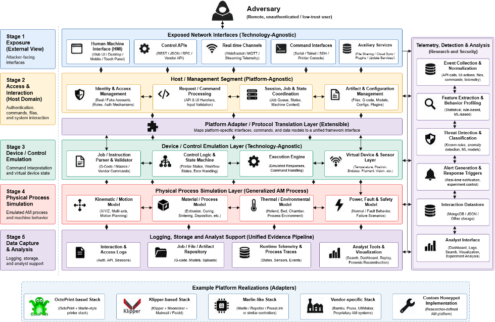

# HoneyPrint - Generalized Additive Manufacturing Honeypot Framework

HoneyPrint is a proposed configuration-driven framework for additive manufacturing (AM) honeypot research. This README follows the design in *HoneyPrint Academic Framework: OctoPrint, Klipper and Custom* and maps it to the current repository structure.

**Implementation status:** the local OctoPrint prototype now supports validated profiles, pinned deployment recipes, managed Virtual Printer startup, passive audit capture, normalized events, bounded queuing, transactional SQLite storage, verified readiness and graceful stop/restart. Read-only attachment supports state polling. A runnable custom HTTP adapter example, versioned extension SDK, rule findings, incremental local alert watcher and read-only evidence dashboard are also implemented. Five manufacturing stages, simplified physical models and private G-code artifact retention are implemented for the custom example. A source-pinned upstream Klipper and Moonraker backend now runs compiled AVR firmware through SimulAVR, with verified MCU readiness, a bounded loopback JSON bridge, state observations and owned container cleanup. Pinned Mainsail assets, live native WebSocket subscriptions, command submission evidence and retained native G-code upload/download are implemented. Uploaded files can execute through Klipper virtual SD and report native print completion. The architecture below remains the full target framework.

## One configuration and one honeypot URL

HoneyPrint uses one `.env` file to select the honeypot. Choose OctoPrint, Klipper or custom, then run the same launcher. Each single-platform selection serves its own interface at the same address: **http://127.0.0.1:8081**. Keep the port and runtime directory unchanged when switching platforms so the address stays the same and framework evidence accumulates in one place.

```text
.env
  |
  +-- HONEYPRINT_PLATFORM=octoprint --> OctoPrint + Virtual Printer
  +-- HONEYPRINT_PLATFORM=klipper   --> Mainsail + Moonraker + Klipper AVR
  +-- HONEYPRINT_PLATFORM=custom    --> Built-in lab / own code / existing API
                                       |
                                       v
                             http://127.0.0.1:8081
                                       |
                                       v
                      .honeyprint/quickstart/events.sqlite3
```

One platform runs at a time in this flow. Changing `.env` takes effect after a restart; it does not replace a running instance automatically.

## Quick start

Use Python 3.10 through 3.13 on macOS or Linux. Selecting Klipper also requires Docker to be installed and running. Copy the template once if you do not already have an `.env` file:

```bash
cp .env.example .env
```

Set the following values in `.env`:

```dotenv
HONEYPRINT_PLATFORM=octoprint
HONEYPRINT_PORT=8081
HONEYPRINT_RUNTIME_DIR=.honeyprint/quickstart
HONEYPRINT_ANALYST_ENABLED=false
HONEYPRINT_CUSTOM_CODE=
HONEYPRINT_CUSTOM_API_URL=
```

Start the selected honeypot:

```bash
./run.sh
```

Open **http://127.0.0.1:8081**. For managed OctoPrint, the local username and password are **admin / admin**. The first launch prepares dependencies for the selected platform; subsequent launches reuse the environment. Initial downloads and builds require internet access and can take several minutes.

## Switch the platform

Change `HONEYPRINT_PLATFORM`, stop the current run, then launch again:

| Selection | Honeypot at the common URL |
| --- | --- |
| `octoprint` | Native OctoPrint with its Virtual Printer and managed audit capture |
| `klipper` | Mainsail with Moonraker and Klipper running compiled AVR firmware through SimulAVR |
| `custom`, with code and API fields blank | Built-in custom printer lab |
| `custom`, with `HONEYPRINT_CUSTOM_CODE` | Your Python HTTP honeypot behind the evidence bridge |
| `custom`, with `HONEYPRINT_CUSTOM_API_URL` | An HTTP bridge to your already running service |

The URL is controlled by `HONEYPRINT_PORT`, not the platform name. `HONEYPRINT_INSTANCE_ID` optionally gives the instance your own name. Leave it blank to use the selected platform's default identity. A new platform implementation that is not built in can use the custom HTTP contract or a registered SDK adapter; entering an arbitrary platform name does not generate its implementation.

Keep `./run.sh` running in the foreground of your terminal. Closing that terminal window or tab sends a hangup signal; the launcher then gracefully stops its owned honeypot services and drains pending evidence. Cleanup may take a few seconds. External services selected through a custom API URL remain running.

Use Ctrl-C in the running terminal, or request a graceful stop from another terminal:

```bash
./.venv/bin/python main.py stop --runtime-dir .honeyprint/quickstart
```

Wait for shutdown to finish, then run `./run.sh` again. If you changed `HONEYPRINT_RUNTIME_DIR`, use that directory in the stop command. An occupied port causes startup to fail with a diagnostic; the launcher does not terminate unrelated services.

## Use your own custom code

Select a trusted Python HTTP entry file in the same `.env`:

```dotenv
HONEYPRINT_PLATFORM=custom
HONEYPRINT_PORT=8081
HONEYPRINT_CUSTOM_CODE=examples/custom_server.py
HONEYPRINT_CUSTOM_API_URL=
HONEYPRINT_CUSTOM_PYTHON=
HONEYPRINT_CUSTOM_HEALTH_PATH=/
HONEYPRINT_RUNTIME_DIR=.honeyprint/quickstart
HONEYPRINT_ANALYST_ENABLED=false
```

Replace the example path with your own entry file. Relative paths resolve from the env file's directory. Set `HONEYPRINT_CUSTOM_PYTHON` if your code requires another interpreter with its dependencies already installed.

Your server must:

- Bind the `HONEYPRINT_HOST` and `HONEYPRINT_PORT` passed to it by the framework. This internal port is separate from the public honeypot port.
- Return a successful response at `HONEYPRINT_CUSTOM_HEALTH_PATH`, with `X-HoneyPrint-Instance` equal to the supplied `HONEYPRINT_INSTANCE_TOKEN`.
- Keep worker processes in its owned process group so framework shutdown can stop them.

The framework supplies `HONEYPRINT_PROFILE_JSON` for the selected printer profile. It starts the code, verifies its health, exposes the common honeypot URL and records observed HTTP interactions. Custom stdout and stderr are retained in a private bounded `custom.log` under the instance directory. The launcher runs trusted developer code; it does not sandbox arbitrary scripts or install their dependencies.

## Use an existing custom API

If your service is already running, configure its HTTP(S) base URL instead of a code path:

```dotenv
HONEYPRINT_PLATFORM=custom
HONEYPRINT_PORT=8081
HONEYPRINT_CUSTOM_CODE=
HONEYPRINT_CUSTOM_API_URL=http://127.0.0.1:5000
HONEYPRINT_CUSTOM_HEALTH_PATH=/
HONEYPRINT_RUNTIME_DIR=.honeyprint/quickstart
HONEYPRINT_ANALYST_ENABLED=false
```

The service can run on another port or host, and the URL can include a base path. Users interact with **http://127.0.0.1:8081**; HoneyPrint forwards requests to the configured service and records methods and response status in the shared database. Stopping HoneyPrint closes its local bridge and leaves the external service running. Requests sent directly to the upstream service bypass HoneyPrint capture.

Give either a custom code path or API URL. The API URL must not contain credentials, a query or a fragment. The custom bridge supports ordinary HTTP GET, POST, PUT and DELETE, with requests up to 1 MiB and responses up to 2 MiB. WebSocket, continuous video streams and non-HTTP protocols require a dedicated adapter. The native OctoPrint and Klipper integrations have their own platform-specific streaming support.

## Keep framework logs in one place

Every selection writes normalized framework evidence to the same runtime directory when `HONEYPRINT_RUNTIME_DIR` remains unchanged:

```text
.honeyprint/quickstart/
  events.sqlite3        # Shared framework and observed platform events
  analysis.sqlite3      # Rule findings from the analysis watcher
  <instance-id>/        # Platform-specific console logs and retained artifacts
```

Events retain platform and instance identity, so records from earlier selections remain distinguishable after a switch. Custom HTTP capture records methods, route category and status without request bodies or credentials. Platform console logs and source-supplied audit plugins can have separate files; the shared database is the framework's normalized evidence store. The analysis watcher runs even when its web dashboard is disabled.

An analyst dashboard is optional. Enable it only when you want a separate interface for reviewing evidence:

```dotenv
HONEYPRINT_ANALYST_ENABLED=true
HONEYPRINT_DASHBOARD_PORT=8090
```

This adds the read-only analyst interface at http://127.0.0.1:8090. It is not required to run the selected honeypot or collect its framework logs.

## Profiles and advanced configuration

Optional `HONEYPRINT_PROFILE`, `HONEYPRINT_WIDTH`, `HONEYPRINT_DEPTH`, `HONEYPRINT_HEIGHT`, `HONEYPRINT_NOZZLE` and `HONEYPRINT_HEATED_BED` configure validated printer profile values. Blank values preserve the profile defaults.

`.env` is a literal settings file, never executed as a shell script. Unknown and duplicate keys are rejected. Process environment values override the file, and explicit CLI settings override generated defaults. Use `--env-file /path/to/settings.env` to select another env file. Env files remain local and are excluded from Git.

Existing YAML configurations remain available through `./run.sh --config /path/to/config.yaml`. Custom connection settings can be passed with `--custom-code` or `--custom-api-url`; use `--no-analyst` to omit the dashboard for an explicit YAML launch. YAML defines the instances and capabilities; the ordinary one-platform flow uses `.env` to generate this configuration automatically.

`HONEYPRINT_PLATFORM=all` is an advanced opt-in for simultaneous instances on separate ports. Leave `HONEYPRINT_PORT` and `HONEYPRINT_INSTANCE_ID` blank in that mode. It is outside the single-platform, common-URL flow described above.

Use `./run.sh --duration 30` for a bounded run. `--no-bootstrap` requires already prepared dependencies, and `--octoprint-python` selects an existing OctoPrint interpreter. Startup waits for persisted lifecycle readiness; when enabled, it also checks the analyst dashboard before reporting readiness. A failed startup shuts down owned children and returns a nonzero exit code.

## Use your local platform source

The same launcher can build trusted local OctoPrint and Klipper source folders. To select your source folders, set:

```dotenv
HONEYPRINT_PLATFORM=octoprint
HONEYPRINT_OCTOPRINT_SOURCE=/absolute/path/to/plat/OctoPrint-dev
HONEYPRINT_KLIPPER_SOURCE=/absolute/path/to/plat/klipper-master
HONEYPRINT_OCTOPRINT_PYTHON=
```

Run `./run.sh`. Change only `HONEYPRINT_PLATFORM` to `octoprint`, `klipper` or `custom` when running one platform; env source paths for other platforms are ignored. Relative source paths resolve from the env file's directory. `--octoprint-source` and `--klipper-source` also accept source folders. Source selection requires bootstrap; it cannot be combined with `--no-bootstrap`.

HoneyPrint hashes and copies the source into `.honeyprint/local-sources`, preserving the original folder. OctoPrint is installed into a separate environment using that source's declared dependencies. Klipper is compiled together with its host software into a separate Docker image, retaining the pinned Moonraker and SimulAVR components and the existing isolated runtime. Archive downloads receive a local snapshot Git commit so native MCU readiness can verify the compiled revision; this is not an upstream commit identifier. Selected source hashes are recorded in deployment recipe metadata. A source change produces a new cache identity on the next launch.

Local virtual environments, nested worktrees, build output and source audit databases are excluded from the snapshot. If the selected OctoPrint source includes `tools/simulated_webcam.py`, HoneyPrint starts it on a separate loopback port and configures the native Control webcam. When `simulated_uploaded_prusa.mp4` is present, the camera loops that source-supplied dark printer video using the pinned video decoder. Otherwise it displays the helper's demo animation. Playback is independent of print state and does not represent actual print motion. Its process is stopped with the managed instance, and camera process failures make runtime health unready. Source-supplied audit plugins retain their own storage; HoneyPrint's normalized telemetry continues through its managed audit plugin.

Initial builds require internet access and may take several minutes. These are trusted developer sources: Python package installation and Docker builds execute their build instructions. The downloaded OctoPrint development version has different dependencies from the pinned release, so the two environments remain separate. Existing supported simulator, telemetry and dashboard behavior still needs runtime compatibility with each selected source version; arbitrary platform forks are not guaranteed to work.

## 1. Research objective and design boundaries

One shared framework should instantiate supported platform implementations through registered adapters. Reusable responsibilities include schema validation, capability checking, instance identity, lifecycle management, normalized telemetry, persistent evidence storage and a read-only analysis dashboard. Platform adapters are responsible for preparing, starting or attaching to, and observing their software.

Configuration selects capabilities that have already been implemented. It cannot generate an OctoPrint API, a Klipper virtual MCU or a custom integration. New functionality requires coded and registered adapters or plugins.

- **Managed mode:** the framework owns the resources it starts.
- **Attach mode:** the framework observes externally managed software and preserves its processes and resources.

## 2. General framework architecture



*Figure 1. General HoneyPrint architecture: exposed interfaces, management, platform adapters, device/control emulation, physical process simulation, and a unified evidence pipeline. OctoPrint, Klipper, Marlin-like, vendor-specific and custom stacks are example platform realizations.*

This figure is the reference architecture. The implementation status above identifies which parts currently run; other blocks represent extension points or research targets.

The five technical stages in the figure describe exposure, interaction, device emulation, physical-process simulation and data capture. They are distinct from the five manufacturing lifecycle stages below. The diagram describes responsibilities, not a requirement for separate processes; observation uses a separate, non-blocking telemetry pipeline.

### AM reference-model mapping

| AM process stage | Framework representation | Illustrative observable activity |
| --- | --- | --- |
| Job intake and authorization | Workflow plugin and authorization model | Login, job submission, actor/session metadata |
| Build preparation | Artifact and preparation handlers | G-code uploads, file changes, profile changes |
| Build execution | Platform adapter and printer simulator | Start, pause, cancel, temperatures, printer status |
| Post-processing | Optional equipment plugins | Wash, cure and finishing state changes |
| Inspection and feedback | Optional quality/records plugins | Inspection queries, reports and approval events |

These are manufacturing lifecycle stages, not technical architecture layers. A deployment may enable a subset and must identify which stages are simulated and which are provided natively by the platform.

## 3. Common configuration and build procedure

The examples in the design sections illustrate the full target framework. For the implemented prototype, use `configs/instances/octoprint.yaml` and `configs/profiles/virtual_lab.yaml`; its stage list is empty because OctoPrint stages are optional and default to disabled. Enabled stages use the shared shadow simulation service rather than submitting native OctoPrint jobs. The custom instance enables the implemented five-stage sequence. Profile paths resolve relative to the selected configuration file.

```yaml
schema_version: 1
instances:
  - id: printer_01
    platform: octoprint       # octoprint | klipper | custom_lab
    deployment: managed      # managed | attach
    printer_profile: configs/profiles/printers/ender3.yaml
    simulation: virtual_printer
    services: {web_port: 8081}
    stages: [intake, preparation, execution]
telemetry:
  backend: sqlite
  capture_requests: true
  capture_commands: true
  capture_state_changes: true
```

Validation must check configuration against declared adapter capabilities and a version-pinned deployment recipe before launch. Unknown keys, port conflicts, incompatible simulation choices, missing adapters and unsupported dependencies must fail validation. Secrets should use environment references or a secret store.

| Phase | Required operation | Output |
| --- | --- | --- |
| Configure | Choose platform, quantity, profile, mode and services | Saved YAML and profile references |
| Validate | Check schema, adapter, recipe, ports, resources and capabilities | Resolved, redacted build plan |
| Prepare | Install or attach to approved runtime components | Prepared environment and setup report |
| Integrate | Connect simulation, instrumentation and collector | Connected instance |
| Launch and verify | Start in dependency order and verify persisted events | Health status and test evidence |
| Stop and restart | Respect ownership, drain queues and revalidate changes | Repeatable lifecycle result |

## 4. Scenario A: Real OctoPrint honeypot

```yaml
instances:
  - id: octo_01
    platform: octoprint
    deployment: managed
    printer_profile: configs/profiles/printers/ender3.yaml
    simulation: virtual_printer
    services: {web_port: 8081}
    instrumentation: {plugin: honeyprint_audit, http: true, gcode: true}
```

The intended OctoPrint adapter resolves a validated recipe, prepares the real server, configures its virtual printer/profile and installs a framework-owned audit bridge. OctoPrint's normal UI and API handle commands. The bridge passively emits observable request, authentication, file, G-code and state events. Clicks that do not produce server requests require separate frontend instrumentation.

Verification requires a working UI, supported virtual printer responses, an observed test command, an event persisted with instance ID `octo_01`, and correct stop/restart behavior. Virtual printer responses do not establish physical extrusion or measurement fidelity.

## 5. Scenario B: Real Klipper / Moonraker / Mainsail honeypot

```yaml
instances:
  - id: klipper_01
    platform: klipper
    deployment: managed
    printer_profile: configs/profiles/printers/voron.yaml
    simulation: virtual_mcu
    frontend: mainsail
    api: moonraker
    services: {web_port: 8082}
    instrumentation: {moonraker_events: true, gcode: true}
```

The intended adapter selects a tested recipe for the Klipper host, Moonraker API and Mainsail frontend. Klipper expects microcontroller communication, so a hardware-free deployment requires a compatible virtual MCU or validated simulation backend. A YAML flag alone does not provide that dependency. Backend readiness must be confirmed before the instance is reported healthy.

Moonraker WebSocket subscriptions, API monitoring and Klipper/G-code observation feed a bridge that normalizes platform-native records. Verification must check temperature/status coherence across Mainsail, Moonraker and simulated execution state. Without a validated MCU backend, validation must report an unsupported capability.

## 6. Scenario C: Researcher-defined custom honeypot

```yaml
instances:
  - id: custom_01
    platform: custom_lab
    adapter: lab_printer_v1
    deployment: managed
    printer_profile: configs/profiles/printers/custom_lab.yaml
    simulation: lab_simulator_v1
    stages: [intake, preparation, execution, postprocessing, inspection]
    services: {web_port: 8090}
    extensions: [quality_records, curing_station]
```

A researcher supplies an adapter with declared capabilities, a deployment recipe, an observation bridge and any required simulator or manufacturing-stage plugins. Registration allows the common core to validate and instantiate it while reusing telemetry, storage and dashboard contracts.

Untrusted YAML must not execute arbitrary Python paths or shell commands. Third-party plugins must be explicitly installed, reviewed, allowlisted and isolated.

### Proposed adapter contract

```python
class PlatformAdapter:
    platform_id: str

    def capabilities(self) -> dict: ...
    def validate(self, cfg, context) -> None: ...
    def prepare(self, plan) -> None: ...
    def launch_or_attach(self, plan) -> object: ...
    def health(self, instance) -> dict: ...
    def observe(self, instance, sink) -> None: ...
    def stop(self, instance, owned_only=True) -> None: ...
```

Separate extension contracts are planned for `PlatformAdapter`, `SimulatorProvider`, `ManufacturingStagePlugin`, `CameraProvider`, `StorageProvider` and `EventNormalizer`. Plugin manifests should declare identifier, API version, capabilities, supported runtime/platform versions, required permissions, health checks and test fixtures.

## 7. What changes when a YAML variable changes?

| Configuration change | Core response | Impact or limitation |
| --- | --- | --- |
| `platform: octoprint` to `klipper` | Select another registered adapter and recipe | Different software stack; compatible MCU simulation required |
| Printer profile changed | Validate and apply supported settings | Does not guarantee hardware-accurate physics |
| Post-processing stage added | Load a registered stage plugin | Requires implemented stage behavior |
| Simulation changed | Resolve a simulator provider | Reject incompatible platform/backend pairs |
| Instance count increased | Assign unique IDs, state, ports and volumes | Isolate resources and logs per instance |
| Instrumentation enabled | Install or attach approved observers | Full click capture requires UI hooks |
| `platform: custom_lab` selected | Resolve the registered custom adapter | Requires adapter code and validation tests |

## 8. Unified observation, storage and security

An illustrative normalized event:

```json
{
  "event_id": "uuid",
  "timestamp": "ISO-8601-UTC",
  "instance_id": "octo_01",
  "platform": "octoprint",
  "source": "api",
  "event_type": "printer.command",
  "session_id": "opaque-session-ref",
  "action": "start_print",
  "outcome": "accepted",
  "simulation": true
}
```

Possible event sources include API, web, plugin and firmware observations. The bridge should minimize interference and send redacted events through a bounded asynchronous queue. The collector should authenticate producers, validate event schemas, deduplicate where appropriate and write to storage. SQLite is the proposed first backend; MongoDB and JSON writers are later options.

Queue admission is not proof of durable persistence. End-to-end verification must read an event back from storage. Health reporting must expose dropped records, backpressure and instrumentation outages.

Planned deployment boundaries include isolated networks, explicitly approved exposed ports, blocked physical device passthrough, constrained container privileges and outbound network policy. Uploaded artifacts should be inspected and stored without automatic execution. Real credentials must remain separate from decoy accounts, and real passwords must not be stored in clear text. Attach mode must not stop or overwrite externally managed platform processes.

## 9. Repository layout

The academic document suggests logical directories such as `simulators/`, `manufacturing/` and `recipes/`. In the current repository, these map to `plugins/simulators/`, `plugins/manufacturing/` and the implemented `recipes/` directory. The earlier `deployment/recipes/` directory remains reserved. The read-only Moonraker client is under `adapters/klipper/`, while `klipper_moonraker/` remains reserved and the custom adapter is under `custom/`; configuration platform IDs remain `klipper` and `custom_lab`.

```text
honeyprint-general-honeypot/
├── adapters/
│   ├── custom/
│   │   └── lab_adapter.py
│   ├── klipper/
│   │   └── moonraker_client.py
│   ├── klipper_moonraker/
│   ├── octoprint/
│   │   ├── adapter.py
│   │   └── audit_plugin.py
│   └── base_adapter.py
├── configs/
│   ├── instances/
│   │   ├── custom.yaml
│   │   ├── klipper.yaml
│   │   └── octoprint.yaml
│   ├── profiles/
│   │   ├── manufacturing/
│   │   ├── printers/
│   │   └── virtual_lab.yaml
│   └── framework.yaml
├── core/
│   ├── builtin_registry.py
│   ├── config_loader.py
│   ├── dependency_resolver.py
│   ├── event_bus.py
│   ├── instance_builder.py
│   ├── lifecycle_manager.py
│   ├── manufacturing_service.py
│   ├── plugin_registry.py
│   ├── profile_loader.py
│   ├── runtime.py
│   ├── state_manager.py
│   └── validator.py
├── dashboard/
│   └── server.py
├── deployment/
│   ├── control.py
│   ├── docker/
│   ├── recipes/
│   └── environment_manager.py
├── examples/
├── plugins/
│   ├── custom/
│   ├── firmware/
│   ├── manufacturing/
│   │   ├── build_execution.py
│   │   ├── build_preparation.py
│   │   ├── inspection.py
│   │   ├── job_intake.py
│   │   ├── pipeline.py
│   │   └── post_processing.py
│   ├── security/
│   ├── services/
│   └── simulators/
│       ├── extrusion.py
│       ├── motion.py
│       ├── printer.py
│       ├── sensors.py
│       └── thermal.py
├── recipes/
│   └── octoprint.py
├── sdk/
│   └── extensions.py
├── telemetry/
│   ├── analysis/
│   │   ├── alerts.py
│   │   ├── evidence.py
│   │   ├── rules.py
│   │   └── service.py
│   ├── storage/
│   ├── artifact_storage.py
│   ├── collector.py
│   ├── normalizer.py
│   └── sqlite_storage.py
├── tests/
│   ├── test_artifact_storage.py
│   ├── test_manufacturing_simulation.py
│   ├── test_manufacturing_service.py
│   ├── test_moonraker_client.py
│   ├── test_extensions_and_analysis.py
│   ├── test_lifecycle.py
│   ├── test_octoprint_integration.py
│   ├── test_planning.py
│   ├── test_profiles.py
│   └── test_telemetry.py
├── .gitignore
├── README.md
├── requirements.txt
├── requirements-octoprint.txt
└── main.py
```

Empty directories are tracked with `.gitkeep`, omitted above.

## Getting started

```bash
git clone https://github.com/imran1846bd/honeyprint-general-honeypot.git
cd honeyprint-general-honeypot
```

Install the YAML dependency and run the shared configuration checks:

```bash
python -m pip install -r requirements.txt
python main.py validate configs/framework.yaml
python -m unittest discover -s tests -v
```

The default configuration has no instances. Built-in registrations are explicit Python factories; custom startup code can pass its own populated registry to `main()`. YAML cannot import or execute uploaded code.

### Run the local OctoPrint prototype

Use Python 3.10–3.13 on macOS or Linux. The verified runtime uses Python 3.13 and OctoPrint 1.11.8. Install OctoPrint into a separate environment; framework preparation checks its version and does not run pip automatically.

```bash
python3 -m venv .venv-octoprint
.venv-octoprint/bin/python -m pip install -r requirements-octoprint.txt
python main.py plan configs/instances/octoprint.yaml --octoprint-python .venv-octoprint/bin/python
python main.py run configs/instances/octoprint.yaml --octoprint-python .venv-octoprint/bin/python
```

The managed Web UI listens at `http://127.0.0.1:8081`. Research login credentials are generated in `.honeyprint/octo_01/credentials.json`, with private file permissions. Keep that runtime directory outside version control. Runtime data includes the owned OctoPrint configuration, its logs, and `.honeyprint/events.sqlite3`.

Stop from another terminal, or press Ctrl-C in the running terminal:

```bash
python main.py stop
```

The stop command acknowledges a shutdown request; the running process confirms final cleanup and telemetry drain. For a bounded smoke run, append `--duration 5`. For a separate runtime directory, pass the same `--runtime-dir` to run and stop. An exclusive instance lock prevents concurrent ownership of one basedir.

Readiness requires the pinned server version, the selected VIRTUAL connection and profile, a temperature response, a live audit observer with no reported drops/errors, and lifecycle evidence read back from SQLite. It does not establish physical printer fidelity. This prototype stays on loopback; public network exposure and container/device isolation remain separate deployment work.

The integration uses OctoPrint's documented [Virtual Printer](https://docs.octoprint.org/en/main/development/virtual_printer.html), [connection API](https://docs.octoprint.org/en/main/api/connection.html) and [plugin hooks](https://docs.octoprint.org/en/main/plugins/hooks.html). Audit hooks enqueue minimal records; a worker sends them over an authenticated local UDP channel. Raw command arguments, request bodies, headers and event payloads are omitted. UDP is best-effort; counters expose observed loss, but do not establish lossless capture. Common credential metadata keys are redacted; producers must handle secrets embedded in free text.

### Read-only attachment

Attachment requires an already operational OctoPrint 1.11.8 server on loopback with its Virtual Printer connected and the matching profile selected. Copy the managed example, change deployment to `attach`, and replace instrumentation with `state: true`. Supply an existing user API key through an environment variable and pass `--attach-api-key-env VARIABLE_NAME`. The framework polls state, never installs plugins or reconnects the external printer, and stop only detaches its observer. HTTP and G-code audit flags are rejected in attach mode because that coverage is not implemented.

### Verify persistence and integration

```bash
python -m unittest discover -s tests -v
HONEYPRINT_OCTOPRINT_PYTHON="$PWD/.venv-octoprint/bin/python" python -m unittest discover -s tests -v
```

The default suite skips the real-server test when the optional interpreter is absent. With it enabled, the test launches a real server, observes commands, reads SQLite events, confirms that attach preserves the external process/configuration, requests graceful stop and restarts the owned server. Collector failures retain the pending batch for retry; pending queue records are in memory and must drain before shutdown.

### Run and extend the custom example

```bash
python main.py run configs/instances/custom.yaml --runtime-dir .honeyprint/custom-demo
python main.py stop --runtime-dir .honeyprint/custom-demo
```

The example listens on loopback port 8083 and provides `GET /api/state` and `POST /api/command` with a JSON body such as `{"command":"G1 X10 Y20"}`. It accepts a bounded G-code subset: G0/G1 (XYZ/E/F), G28, G90/G91, M82/M83, M104/M140, M105, M112 and G4. Motion advances at the configured feedrate, heaters follow a deterministic first-order response, and extrusion checks temperature and filament availability. Each accepted command advances one simulated second; G4 also advances its explicit virtual duration. These simplified models are not calibrated printer physics or a Klipper MCU backend.

The default custom configuration enables all five manufacturing stages. Submit a data-only job through `POST /api/job`:

```bash
curl -H 'Content-Type: application/json' http://127.0.0.1:8083/api/job \
  -d '{"gcode":"G28\nM104 S200\nG4 S90\nG1 X10 Y20 E5"}'
```

Intake bounds UTF-8 G-code and computes its SHA-256 identity; preparation preflights a detached printer state; execution applies the simulated commands; post-processing turns off heaters and cools; inspection reports process consistency. Stages must be an ordered prefix beginning with intake. Rejected jobs leave printer state unchanged. Inspection does not measure physical part quality. Each completed stage emits normalized evidence with artifact hash and size. Accepted raw G-code is preserved as a private SHA-256-named artifact under `<runtime-dir>/artifacts/<instance-id>/`; uploads cannot execute Python or shell code. Default retention bounds are 100 MiB and 1000 artifacts per instance, with duplicate content reusing its existing file. Integrity checks detect changed content, and reaching a quota rejects new jobs without applying simulated state. Rejected job content is not retained. JSON request bodies are bounded to one MiB; command requests are bounded to 4096 bytes.

Sensor fault injection is currently a Python simulation API (`SensorModel.set_fault`), not an exposed network endpoint. Emergency stop disables motion and heaters; the simulated instance must be restarted to restore power.

Installed developer code can use a startup manifest through `sdk.extensions.register_extension`:

```python
from core.plugin_registry import PluginRegistry
from sdk.extensions import register_extension
from main import main

registry = PluginRegistry()
register_extension(registry, {
    "api_version": 1,
    "name": "my_extension",
    "plugins": [
        {"kind": "platform_adapter", "id": "my_platform", "factory": MyAdapter},
        # Also register the implemented simulator, recipe and storage factories.
    ],
})
main(registry=registry)
```

`MyAdapter` must be imported by your trusted startup code and implement the platform contract. The manifest preflights version, identifiers and collisions before registration. Factories are not executed during registration. The `.env` custom entry path now supports an owned local HTTP server without SDK registration. There is no network code-upload/import endpoint or sandbox for arbitrary Python packages.

### Explore evidence and local rule alerts

After a runtime has created its evidence database:

```bash
python -m telemetry.analysis.service --database .honeyprint/events.sqlite3 --alerts .honeyprint/analysis.sqlite3
python -m dashboard.server --database .honeyprint/events.sqlite3 --alerts .honeyprint/analysis.sqlite3
```

The dashboard listens at `http://127.0.0.1:8090`, supports instance/type filters and bounded pagination, and exposes `GET /api/events` and `GET /api/alerts`. It opens databases read-only, escapes captured text and rejects POST writes. Derived findings are stored in a separate database, leaving raw evidence unchanged.

For ongoing local notifications, run the analysis command with `--watch` alongside the framework. Findings cover denied API access, unknown endpoints, emergency-stop commands, rejected commands and platform interruptions. They are contextual indicators, not confirmed attacks. Checkpoints and deterministic finding IDs prevent duplicate results on restart. No email, messaging service or ML classifier is configured.

### Shared manufacturing service

When an instance enables an ordered stage sequence, `FrameworkRuntime` exposes `instance.resources["manufacturing"]`. Trusted startup code can call its `submit(gcode_bytes)` method from `on_ready(instance, report)` or its own integration layer. Selected stage providers come from the immutable dependency plan, so registered providers are used instead of silently selecting built-in functions. Artifact storage and normalized stage evidence are shared across platforms.

This service executes a **shadow simulation**. It does not send commands to OctoPrint, Klipper or physical hardware. The service reports `execution_mode: shadow`, retains accepted G-code artifacts and closes before runtime telemetry cleanup. If an evidence sink rejects a stage, simulated state remains unchanged and further submissions fail until a new service is created; already accepted evidence is not rolled back. The custom `/api/job` endpoint retains its own simulated printer state and job pipeline.

The test suite runs shadow jobs on both the real pinned OctoPrint runtime and the custom HTTP runtime, checks platform-tagged SQLite evidence and rejects submissions after shutdown. There is no public HTTP endpoint for the shared service yet; it is a trusted Python integration API.

### Moonraker read-only transport

`adapters.klipper.moonraker_client.MoonrakerClient` can inspect an existing loopback Moonraker port or a user-managed SSH tunnel. It uses bounded GET requests for server, printer and selected object status, optionally checking explicit Klipper/Moonraker version strings and reading an API key from an environment variable. It sends no printer commands and omits server paths and credentials from returned evidence. Its transport tests use an HTTP protocol fixture. The managed Klipper adapter separately verifies actual upstream AVR MCU communication and does not depend on this attachment helper.

The transport follows Moonraker's official [HTTP API introduction](https://moonraker.readthedocs.io/en/latest/external_api/introduction/) and [printer administration API](https://moonraker.readthedocs.io/en/latest/external_api/printer/).

### Managed Klipper AVR backend

The Docker image builds pinned Klipper, Moonraker and official SimulAVR sources, compiles Klipper for an ATmega644P simulated MCU and feeds heater-driven analog thermistor voltages into that MCU. Readiness verifies native Klippy connectivity, the compiled MCU revision, serial counters and temperature feedback. The MCU is a software emulator; homing uses explicit virtual coordinates, and the thermal model is simplified. Emulator execution speed is not calibrated physical printer timing.

The container runs without root, capabilities, host device mounts or a Docker socket mount, with a read-only root, bounded temporary filesystems and CPU, memory, process and log limits. Its internal Docker network blocks external egress. A concurrent loopback bridge serves verified Mainsail assets and forwards selected native HTTP and live WebSocket JSON-RPC endpoints through Docker exec. Native responses and status notifications originate from Moonraker. Host power/service control and software updates are excluded. Observed routes/status, RPC methods, submitted G-code identifiers and native printer state enter the framework telemetry pipeline; raw command arguments are omitted. Submission evidence does not prove every line of an uploaded file was executed.

Native multipart uploads accept UTF-8 G-code files up to one MiB with simple filenames in the G-code root. The host retains content-addressed evidence before forwarding; successful uploads produce artifact metadata. The container's native G-code files are temporary and disappear on shutdown; retained host evidence survives. Configuration uploads and arbitrary executable files are rejected. Mainsail can upload, list and select G-code and start a native virtual-SD print, then receive live completion/status updates.

Mainsail is pinned to release 2.19.0 with archive SHA-256 `c4d9d96f89851c6ae0709c2f20725447f3fe8c57cf193869b0083441bd93378a`. Bootstrap verifies the archive, limits extraction and rejects unsafe paths. Cached file hashes are checked before serving. The official [Mainsail configuration reference](https://github.com/mainsail-crew/mainsail/blob/master/public/config.json) and [Moonraker file API](https://moonraker.readthedocs.io/en/latest/external_api/file_manager/) describe the native interfaces.

```bash
./run.sh --config configs/instances/klipper.yaml
HONEYPRINT_TEST_KLIPPER=1 .venv/bin/python -m unittest discover -s tests -p test_klipper_runtime.py -v
```

Real Docker integration tests verify native movement, MCU communication, blocked egress, request/state observations, owned cleanup and restart. Frontend integration verifies served Mainsail assets/configuration, simultaneous WebSocket RPC replies, status subscriptions, upload/download integrity, artifact retention, native print completion and cleanup with an open connection. Browser visual inspection requires local computer-use permissions; automated verification exercises the native interfaces directly. Containers and networks use unique ownership labels; cleanup refuses resources with a different owner.

## Implementation sequence

1. Implemented: schemas, extension contracts, registry and capability validation.
2. Implemented: dependency planning, resource ownership, lifecycle and health reporting.
3. Implemented: pinned local OctoPrint recipe, Virtual Printer integration and audit bridge.
4. Implemented: normalized telemetry, SQLite persistence and event readback.
5. Implemented: managed upstream Klipper, Moonraker, AVR MCU simulation, pinned Mainsail, bounded native HTTP/upload/download and live WebSocket subscriptions.
6. Implemented: custom adapter example, versioned SDK, read-only analysis, contextual rules and local alerts. The custom example now runs ordered manufacturing-stage plugins and simplified motion, thermal, extrusion and sensor simulation. OctoPrint and custom runtimes can use the shared shadow manufacturing service; native platform job execution and optional additional protocols and full execution auditing remain separate work.
7. Implemented for this prototype: contract tests and real OctoPrint attach, persistence, shutdown and restart checks. Extend coverage as further platforms are added.

## License and citation

No license or citation file has been added yet. License selection and author/publication details remain to be documented. Third-party source code and Mainsail release assets are downloaded into local runtime/image caches, rather than committed to this repository.
