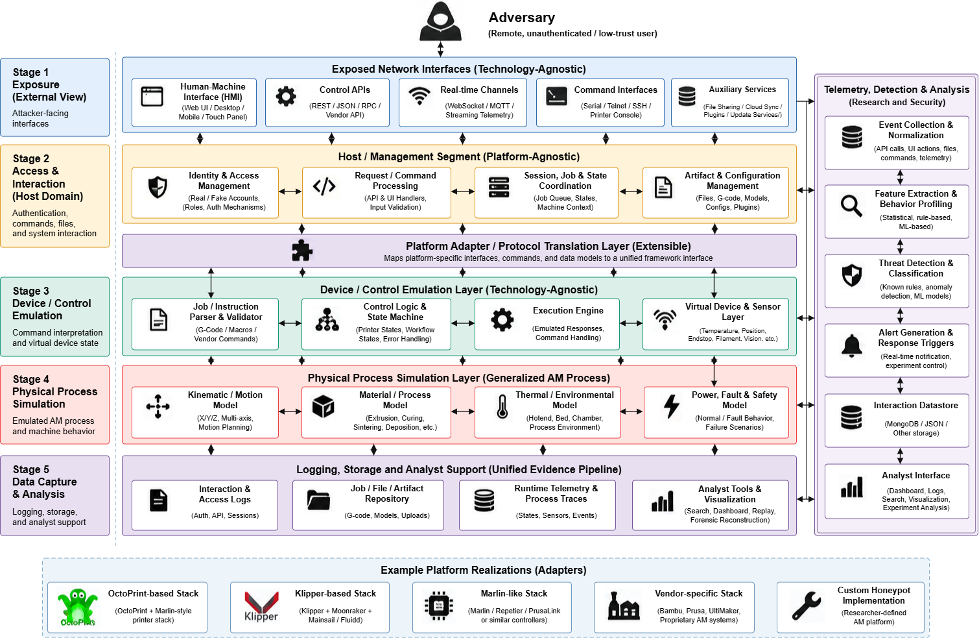

# HoneyPrint - Generalized Additive Manufacturing Honeypot Framework

HoneyPrint is a proposed configuration-driven framework for additive manufacturing (AM) honeypot research. This README follows the design in *HoneyPrint Academic Framework: OctoPrint, Klipper and Custom* and maps it to the current repository structure.

**Implementation status:** the local OctoPrint prototype now supports validated profiles, pinned deployment recipes, managed Virtual Printer startup, passive audit capture, normalized events, bounded queuing, transactional SQLite storage, verified readiness and graceful stop/restart. Read-only attachment supports state polling. A runnable custom HTTP adapter example, versioned extension SDK, rule findings, incremental local alert watcher and evidence dashboard with CSV export and log clearing are also implemented. Five manufacturing stages, simplified physical models and private G-code artifact retention are implemented for the custom example. A source-pinned upstream Klipper and Moonraker backend now runs compiled AVR firmware through SimulAVR, with verified MCU readiness, a bounded loopback JSON bridge, state observations and owned container cleanup. Pinned Mainsail assets, live native WebSocket subscriptions, command submission evidence and retained native G-code upload/download are implemented. Uploaded files can execute through Klipper virtual SD and report native print completion. The architecture below remains the full target framework.

## One configuration and one honeypot URL

HoneyPrint uses one `.env` file to select the honeypot. Choose OctoPrint, Klipper or custom, then run the same launcher. Each single-platform selection serves its own interface at the same address: **http://127.0.0.1:8084**. Keep the port and runtime directory unchanged when switching platforms so the address stays the same. Managed framework modes write evidence to the shared runtime database.

```text
.env
  |
  +-- HONEYPRINT_PLATFORM=octoprint      --> Native OctoPrint + Virtual Printer
  +-- HONEYPRINT_PLATFORM=octoprint-main --> OctoPrint Main (bundled simulator)
  +-- HONEYPRINT_PLATFORM=klipper   --> Mainsail + Moonraker + Klipper AVR
  +-- HONEYPRINT_PLATFORM=custom    --> Built-in lab / own code / existing API
                                       |
                                       v
                             http://127.0.0.1:8084
```

One platform runs at a time in this flow. Changing `.env` takes effect after a restart; it does not replace a running instance automatically.

## Download and run on macOS

Follow these steps from a **new GitHub ZIP download**. Run the commands inside the extracted project folder, not inside the original developer folder.

### 1. Download the project

Open [the HoneyPrint GitHub repository](https://github.com/imran1846bd/honeyprint-general-honeypot), choose **Code → Download ZIP**, extract it, and place the resulting `honeyprint-general-honeypot-main` folder on your Desktop. Open Terminal:

```bash
cd "$HOME/Desktop/honeyprint-general-honeypot-main"
ls run.sh .env.example
```

If you extracted it elsewhere, change the `cd` path to that folder. To use Git instead of a ZIP, run:

```bash
cd "$HOME/Desktop"
git clone https://github.com/imran1846bd/honeyprint-general-honeypot.git
cd honeyprint-general-honeypot
```

### 2. Check the prerequisites

- Install Python **3.11, 3.12 or 3.13**. Python 3.13 is recommended for this project. The launcher chooses an installed supported version automatically even if `python3` points to Python 3.15. If no supported version exists, it stops with a clear message. Check for Python 3.13 with `python3.13 --version`.
- Internet access is needed on the first run to install pinned Python packages and prepare the selected platform. A first build may take several minutes.
- Docker is required **only** when selecting `klipper` or `octoprint-main`. Start Docker before those selections; `docker info` should succeed. The default native OctoPrint selection does not require Docker.
- Run `./run.sh` to install the required packages. You do not need to run `pip install -r requirements.txt` manually.

If you previously tried the project with Python 3.15, the current launcher saves that incompatible `.venv` inside `.honeyprint/` and builds a new one with a supported Python. An incomplete OctoPrint source installation is rebuilt automatically. Your `.env` and saved evidence are preserved.

### 3. Select one honeypot in `.env`

The launcher creates `.env` from `.env.example` on first run. To edit settings before starting, create it without overwriting an existing file and open it in TextEdit:

```bash
[ -f .env ] || cp .env.example .env
open -e .env
```

For the default OctoPrint run, keep these values:

```dotenv
HONEYPRINT_PLATFORM=octoprint
HONEYPRINT_PORT=8084
HONEYPRINT_RUNTIME_DIR=.honeyprint/quickstart
HONEYPRINT_ANALYST_ENABLED=true
HONEYPRINT_DASHBOARD_PORT=8090
```

Set `HONEYPRINT_PLATFORM=klipper` for Mainsail/Klipper, `octoprint-main` for the bundled simulator, or `custom` for the custom lab. Each selection uses the same `HONEYPRINT_PORT` but a different interface. The common file is `.env`; edit `configs/platforms/octoprint.yaml`, `klipper.yaml` or `custom.yaml` only for platform-specific options. Save the file before starting. Do not run `source .env`: the launcher reads it as literal settings.

SSH, Telnet and MQTT are **off by default**. To enable one, change its `HONEYPRINT_*_ENABLED` value in `.env` to `true`. Their default ports are 2223, 2323 and 1884, respectively. The analyst dashboard is on by default.

### 4. Start and open the interfaces

From the folder containing `run.sh`, run:

```bash
./run.sh
```

Wait until Terminal prints **`Local services ready`**. Keep that Terminal window open; Ctrl-C stops the honeypot. If Terminal says `Permission denied`, run `chmod +x run.sh` and try again.

| Interface | Default address | When available |
| --- | --- | --- |
| Selected honeypot | `http://127.0.0.1:8084` | After readiness; uses the selected platform's UI |
| Analyst dashboard | `http://127.0.0.1:8090` | When `HONEYPRINT_ANALYST_ENABLED=true` |
| SSH console | `ssh -p 2223 admin@127.0.0.1` | When `HONEYPRINT_SSH_ENABLED=true` |
| Telnet console | `telnet 127.0.0.1 2323` | When `HONEYPRINT_TELNET_ENABLED=true` |
| MQTT broker | `127.0.0.1:1884` | When `HONEYPRINT_MQTT_ENABLED=true` |

The managed OctoPrint research login is `admin` / `admin` unless you changed its credentials. For console commands and MQTT topics, see [commands.md](commands.md). The analyst dashboard shows captured events; its address is separate from the honeypot UI.

### 5. Stop, switch or restart

Press **Ctrl-C** in the running Terminal and wait for `Stopped cleanly`. Edit `.env`, save it, then run `./run.sh` again. Configuration changes are read at startup, not while a honeypot is running. Run only one selected platform on the common port at a time.

If the original Terminal window is gone and the launcher says `This runtime is already running`, request a graceful stop from a new Terminal in the project folder:

```bash
./.venv/bin/python main.py stop --runtime-dir .honeyprint/quickstart
```

Wait for shutdown before starting again. If you changed `HONEYPRINT_RUNTIME_DIR`, use that value in the stop command. Uploaded G-code and evidence stay in the runtime directory across normal restarts; a fresh ZIP extraction starts with fresh runtime data unless you move those local files yourself.

### 6. Find logs and handle common startup errors

With the default runtime directory, raw interaction evidence is in `.honeyprint/quickstart/events.sqlite3`, analysis and ML results are in `.honeyprint/quickstart/analysis.sqlite3`, and the dashboard is at port 8090. The launcher also prints these paths after readiness.

- **Python 3.15 / incompatible OctoPrint:** use the current GitHub download and ensure Python 3.11–3.13 is installed. The current launcher picks a compatible interpreter and replaces only generated, incompatible environments.
- **Port already in use:** stop the earlier HoneyPrint run. If a different app owns the port, change `HONEYPRINT_PORT` or `HONEYPRINT_DASHBOARD_PORT` in `.env`, save, and restart. The printed URL changes with the port.
- **Klipper or OctoPrint Main build fails:** verify Docker is running with `docker info`, then retry `./run.sh`.
- **Dashboard does not open:** check that `.env` has `HONEYPRINT_ANALYST_ENABLED=true`, wait for the readiness message, and use the printed dashboard URL.

For a short verification that stops automatically after readiness, run `./run.sh --duration 5`. This starts the selected services, keeps them ready for five seconds, then closes them cleanly.

### What a GitHub clone contains

The Git package includes the framework code, platform configuration, the OctoPrint and Klipper source under `plat/`, and the reviewed v9 model under `models/`. It excludes your `.env`, uploaded files, evidence databases, installed Python environments, Docker images, build caches, and the framework's local test suite. The first run creates `.env` from `.env.example`, installs dependencies, prepares the selected platform, and creates fresh runtime storage in `.honeyprint/`. Internet access is needed for the initial dependency and frontend downloads. Use Ctrl-C to stop the services; the next `./run.sh` reuses prepared local dependencies.

The default template selects OctoPrint at `http://127.0.0.1:8084` and the analyst dashboard at `http://127.0.0.1:8090`. Optional SSH, Telnet and MQTT listeners use ports 2223, 2323 and 1884 when enabled. To use Klipper, set `HONEYPRINT_PLATFORM=klipper` in `.env` and ensure Docker is running. To use your own custom backend, select `custom` and configure `configs/platforms/custom.yaml`. Runtime logs remain local and are never part of the GitHub package.

OctoPrint Main serves the bundled `adapters/octoprint -main` application on the loopback address and stores files and logs in its Docker volumes. The same SSH, Telnet, MQTT and analyst settings apply to OctoPrint Main. Its default instance ID is `octo_main_01`, so its MQTT topics start with `honeyprint/octo_main_01/`. Web/API activity, G-code commands, uploads and print state events join companion activity in the shared evidence database when their capture options are enabled. To switch to the native OctoPrint integration, set `HONEYPRINT_PLATFORM=octoprint` and restart `./run.sh`.

To add the simulated SSH printer console in a managed framework mode, set these values in `.env` and restart:

```dotenv
HONEYPRINT_SSH_ENABLED=true
HONEYPRINT_SSH_HOST=127.0.0.1
HONEYPRINT_SSH_PORT=2223
HONEYPRINT_SSH_USERNAME=admin
HONEYPRINT_SSH_PASSWORD=admin
```

In another terminal, connect with `ssh -p 2223 admin@127.0.0.1` and enter the configured password. `help` lists the supported virtual-printer commands. You can upload a G-code file (`.gcode`, `.gco`, `.g` or `.nc`; slicer names such as `Benchy [0.2mm] #2.gcode` are fine) with `upload demo.gcode`, paste its lines, and finish with a single `.` line; then run `files`, `select demo.gcode`, `start`, and `job`. For a local file, use `ssh -p 2223 admin@127.0.0.1 'upload demo.gcode' < examples/console_demo.gcode`. The console controls the selected managed virtual printer through its local API; it never runs a host shell. Authentication, command names, and upload metadata enter the shared evidence database without passwords or G-code content. The SSH host key remains private under the runtime directory.

To add Telnet, set `HONEYPRINT_TELNET_ENABLED=true` in `.env` and restart. Connect with `telnet 127.0.0.1 2323` (or `nc 127.0.0.1 2323`) and use the same virtual-printer commands as SSH, including pasted G-code upload. Both consoles share the selected printer, files, job, and evidence database. Telnet credentials are transmitted without encryption, so its default listener is restricted to `127.0.0.1`.

For a manual test without editing `.env`, run `HONEYPRINT_TELNET_ENABLED=true ./run.sh` in the project directory. After it reports readiness, run `telnet 127.0.0.1 2323` in a second terminal. Enter the configured username and password (both `admin` by default), then try `help`, `status`, `M105`, `M115` and `exit`. Stop the launcher with Ctrl-C when finished.

The optional MQTT companion is configured by `HONEYPRINT_MQTT_ENABLED`, `HONEYPRINT_MQTT_HOST`, `HONEYPRINT_MQTT_PORT`, `HONEYPRINT_MQTT_USERNAME`, and `HONEYPRINT_MQTT_PASSWORD`. It implements a bounded MQTT 3.1.1 subset. Subscribe to `honeyprint/<instance-id>/#`; publish supported printer commands to `honeyprint/<instance-id>/command` and G-code bytes to `honeyprint/<instance-id>/upload/NAME.gcode`. Responses and live state/temperature updates appear on the corresponding topics. For the current local port and a complete example, see [commands.md](commands.md). MQTT routes commands to the same selected managed virtual printer as SSH and Telnet, and stores interaction metadata in the common evidence database. It does not implement MQTT 5, QoS 2, persistent sessions, or a general-purpose broker.

Open **http://127.0.0.1:8084**. For managed OctoPrint, the local username and password are **admin / admin**. The first launch prepares dependencies for the selected platform; subsequent launches reuse the environment. Initial downloads and builds require internet access and can take several minutes.

## Switch the platform

Change `HONEYPRINT_PLATFORM`, stop the current run, then launch again:

| Selection | Honeypot at the common URL |
| --- | --- |
| `octoprint` | Native OctoPrint with its Virtual Printer and managed audit capture |
| `octoprint-main` | Bundled OctoPrint Main simulator from `adapters/octoprint -main` |
| `klipper` | Mainsail with Moonraker and Klipper running compiled AVR firmware through SimulAVR |
| `custom`, with code and API fields blank | Built-in custom printer lab |
| `custom`, with `code` in `configs/platforms/custom.yaml` | Your Python HTTP honeypot behind the evidence bridge |
| `custom`, with `api_url` in `configs/platforms/custom.yaml` | An HTTP bridge to your already running service |

The URL is controlled by `HONEYPRINT_PORT`, not the platform name. The scenario YAML shown below illustrates the design; for a runnable launch use `.env` or the files under `configs/instances/`. `HONEYPRINT_INSTANCE_ID` optionally gives the instance your own name. Use `auto` (or blank for compatibility) to keep the selected platform's default identity. A new platform implementation that is not built in can use the custom HTTP contract or a registered SDK adapter; entering an arbitrary platform name does not generate its implementation.

Keep `./run.sh` running in the foreground of your terminal. Closing that terminal window or tab sends a hangup signal; the launcher then gracefully stops its owned honeypot services and drains pending evidence. Cleanup may take a few seconds. External services selected through a custom API URL remain running.

Use Ctrl-C in the running terminal, or request a graceful stop from another terminal:

```bash
./.venv/bin/python main.py stop --runtime-dir .honeyprint/quickstart
```

Wait for shutdown to finish, then run `./run.sh` again. If you changed `HONEYPRINT_RUNTIME_DIR`, use that directory in the stop command. An occupied port causes startup to fail with a diagnostic; the launcher does not terminate unrelated services.

## Use your own custom code

Set `HONEYPRINT_PLATFORM=custom` in the common `.env`, then edit `configs/platforms/custom.yaml`:

```yaml
schema_version: 1
code: examples/custom_server.py
api_url: ''
python: ''
health_path: /
```

Replace `code` with your trusted entry file. Relative platform paths resolve from the project root containing `configs/platforms/`. Set `python` when your code requires another interpreter; an empty value uses the framework interpreter.

Your server must:

- Bind the `HONEYPRINT_HOST` and `HONEYPRINT_PORT` passed to it by the framework. This internal port is separate from the public honeypot port.
- Return a successful response at `HONEYPRINT_CUSTOM_HEALTH_PATH`, with `X-HoneyPrint-Instance` equal to the supplied `HONEYPRINT_INSTANCE_TOKEN`.
- Keep worker processes in its owned process group so framework shutdown can stop them.

The framework supplies `HONEYPRINT_PROFILE_JSON` for the selected printer profile. It starts the code, verifies its health, exposes the common honeypot URL and records observed HTTP interactions. Custom stdout and stderr are retained in a private bounded `custom.log` under the instance directory. The launcher runs trusted developer code; it does not sandbox arbitrary scripts or install their dependencies.

## Use an existing custom API

Set `HONEYPRINT_PLATFORM=custom` in `.env`. In `configs/platforms/custom.yaml`, select an existing HTTP(S) service instead of code:

```yaml
schema_version: 1
code: ''
api_url: http://127.0.0.1:5000
python: ''
health_path: /
```

The service can run on another port or host, and the URL can include a base path. Users interact with **http://127.0.0.1:8084**; HoneyPrint forwards requests to the configured service and records methods and response status in the shared database. Stopping HoneyPrint closes its local bridge and leaves the external service running. Requests sent directly to the upstream service bypass HoneyPrint capture.

Give either a custom code path or API URL. The API URL must not contain credentials, a query or a fragment. The custom bridge supports ordinary HTTP GET, POST, PUT and DELETE, with requests up to 1 MiB and responses up to 2 MiB. WebSocket, continuous video streams and non-HTTP protocols require a dedicated adapter. The native OctoPrint and Klipper integrations have their own platform-specific streaming support.

## Keep framework logs in one place

Every selection writes normalized framework evidence to the same runtime directory when `HONEYPRINT_RUNTIME_DIR` remains unchanged:

```text
.honeyprint/quickstart/
  events.sqlite3        # Shared framework and observed platform events
  analysis.sqlite3      # Rule findings from the analysis watcher
  artifacts/<instance-id>/ # Framework-retained G-code artifacts
  <instance-id>/        # Platform-specific console logs
```

Events retain platform and instance identity, so records from earlier selections remain distinguishable after a switch. Custom HTTP capture records methods, route category and status without request bodies or credentials. Platform console logs and source-supplied audit plugins can have separate files; the shared database is the framework's normalized evidence store. The analysis watcher is controlled by `HONEYPRINT_ANALYSIS_ENABLED`, independently of the web dashboard. With analysis disabled, the dashboard still serves evidence and shows no findings.

The default `.env` starts the analyst dashboard with `./run.sh`:

```dotenv
HONEYPRINT_ANALYST_ENABLED=true
HONEYPRINT_DASHBOARD_PORT=8090
```

The terminal prints its URL and port after readiness. Open http://127.0.0.1:8090 to review the selected platform's interactions and print-job evidence. OctoPrint, Klipper and custom use the same evidence and analysis database paths when selected; records retain their platform and instance IDs. Set `HONEYPRINT_ANALYST_ENABLED=false` or use `--no-analyst` to run without the dashboard; evidence capture continues.

### Optional live ML classification

The repository includes `models/HoneyPrint_ATTACK_Model_v9.zip`, and `.env.example` selects it with `HONEYPRINT_ML_MODEL_ZIP=models/HoneyPrint_ATTACK_Model_v9.zip`. Restart `./run.sh` after changing the model path. The launcher checks the archive and starts the model worker after evidence storage is ready. It installs the pinned packages in `requirements-ml.txt` into the local environment if needed. The dashboard's **Attack classification** column and CSV download then include the model's section, subsection, confidence and review status as each stored interaction is processed. The `/api/live` and `/api/events` responses include an `ml_prediction` object. All predictions are stored separately in `analysis.sqlite3`; raw events in `events.sqlite3` are unchanged.

The **AM process mapping** column uses explicit event and route rules. The v9 classifier proposes ATT&CK technique IDs; low-confidence or unsupported event types use transparent classification rules. Routine honeypot use is mapped to its closest observable technique, which does not establish attacker intent. The model was trained on controlled scenarios, so its confidence is not proof of an attack. Keep new private models and runtime evidence under `.honeyprint/`; only the reviewed starter model is bundled. Stop the current run with Ctrl-C before replacing the model or changing this setting.

## Profiles and advanced configuration

`HONEYPRINT_PROFILE`, `HONEYPRINT_WIDTH`, `HONEYPRINT_DEPTH`, `HONEYPRINT_HEIGHT`, `HONEYPRINT_NOZZLE` and `HONEYPRINT_HEATED_BED` configure validated printer profile values. The common template supplies explicit geometry defaults (220 × 220 × 250 mm, 0.4 mm nozzle, heated bed). Blank geometry values remain supported to inherit a selected profile. Current profiles describe single-extruder rectangular geometry; new motion/thermal/sensor models are not introduced by these controls.

`.env` is a literal settings file, never executed as a shell script. Unknown and duplicate keys are rejected. Process environment values override the file, and explicit CLI settings override generated defaults. Use `--env-file /path/to/settings.env` to select another env file. Env files remain local and are excluded from Git.

Existing YAML configurations remain available through `./run.sh --config /path/to/config.yaml`. Custom connection settings can be passed with `--custom-code` or `--custom-api-url`; use `--no-analyst` to omit the dashboard for an explicit YAML launch. YAML defines the instances and capabilities; the ordinary one-platform flow uses `.env` to generate this configuration automatically.

`HONEYPRINT_PLATFORM=all` is an advanced opt-in for simultaneous instances on separate ports. Leave `HONEYPRINT_PORT` and `HONEYPRINT_INSTANCE_ID` blank in that mode. It is outside the single-platform, common-URL flow described above.

Use `./run.sh --duration 30` for a bounded run. `--no-bootstrap` requires already prepared dependencies, and `--octoprint-python` selects an existing OctoPrint interpreter. Startup waits for persisted lifecycle readiness; when enabled, it also checks the analyst dashboard before reporting readiness. A failed startup shuts down owned children and returns a nonzero exit code.

## Common printer and storage options

The common `.env` also supports these options; restart to apply changes:

| Option | Default | Applied behavior |
| --- | --- | --- |
| `HONEYPRINT_PRINTER_NAME` | HoneyPrint Virtual Lab | Shared profile name; OctoPrint appearance/profile, built-in lab title/state, custom-process profile contract and Klipper bridge profile endpoint. Does not rename an external API or Mainsail's own UI preferences. |
| `HONEYPRINT_ARTIFACT_DIR` | `auto` | `<runtime>/artifacts`, or an explicit absolute/path relative to `.env`; each instance has a subdirectory. All framework artifact stores use it. No automatic migration. |
| `HONEYPRINT_PREHEAT_HOTEND_C` / `HONEYPRINT_PREHEAT_BED_C` | 200 / 60 | User-activated targets, not startup heating or physical temperature ceilings. OctoPrint Temperature preset; lab Preheat button/`POST /api/preheat` with `{}`; Klipper `POST /printer/honeyprint/preheat` with `{}`. A printer without a heated bed skips the bed command. |
| `HONEYPRINT_CAMERA_ENABLED` | true | Allow the managed OctoPrint camera when available; false disables it. Other backends do not gain a framework camera from this flag. |
| `HONEYPRINT_CAMERA_SOURCE` | `auto` | Preserve source helper/video selection. OctoPrint can use a local video with its source camera helper or an HTTP(S) stream URL. URL display does not verify remote stream availability or add snapshot support. Explicit sources are rejected for other backends. |

`GET /server/honeyprint/profile` exposes the selected shared profile through the Klipper HTTP bridge. Generic custom code receives the profile JSON as before; external APIs retain control of their own printer identity and heaters. Read-only attached OctoPrint does not apply camera or preheat overrides; non-default values are rejected. Non-default preheat settings for custom code/API deployments are rejected because those deployments have no standard heater command contract. Their unchanged default preset values are inactive.

Built-in request and artifact limits remain in `core/runtime_settings.py`; they are intentionally omitted from the small common template. Advanced YAML can override supported runtime settings after validation. These limits apply at the owned HTTP entry point, not to direct requests to an external upstream. Artifact retention is distinct from upload admission. Missing parent directories for retained artifacts are created on first store preparation.

## Common runtime controls

Every active assignment in `.env.example` is wired to a consumer. `.env` holds common settings only; platform-specific code/source/interpreter/API paths belong in the selected platform YAML. Legacy platform-specific env keys are accepted for compatibility, but are absent from the common file and template.

| Common group | Effect |
| --- | --- |
| Evidence database names, SQLite timeout | Shared by runtime, readiness checks, analysis and dashboard; names must be distinct plain `.sqlite3` filenames |
| Run duration | `0` means until stop; positive seconds start after launcher readiness; explicit `--duration` wins |
| Startup/readiness/shutdown timeouts | Bound launcher readiness, core post-start readiness and graceful child-process waiting; adapter startup/builds have their own platform limits |
| Health and collector intervals | Independently schedule health checks and evidence draining |
| Capture flags | Filter supported observations; framework lifecycle evidence is always persisted |
| Queue/batch/drain limits | Configure common queue and collection work; overflow or undrained shutdown evidence fails the run |
| Artifact limits | Per framework artifact store, not a platform disk quota. The adapters treat the built-in default size values as unbounded and retain up to 1000 artifacts; explicit limits are validated in `core/runtime_settings.py` |
| Analysis options | Enable/disable analysis and set its polling interval/batch size |
| Analyst options | Enable/disable UI and set port, pagination, connection timeout and startup wait |

Changing runtime paths or database names starts using the new destination; old evidence is retained and is not automatically migrated. Restart after changing configuration. No upload is executed as framework code unless explicitly selected as trusted custom code in its platform YAML.

Generated YAML carries these controls in its validated `runtime` mapping. Explicit `--config` uses that YAML's `runtime` mapping (or defaults), bypassing `.env` selection. Values outside the ranges in `core/runtime_settings.py` fail before dependency bootstrap. Platform-specific `.yaml` files are configuration data, never Python imports.

## Use your local platform source

The common `.env` contains no platform source paths. The launcher automatically reads only `configs/platforms/<selected-platform>.yaml` (all three in advanced `all` mode).

For OctoPrint, edit `configs/platforms/octoprint.yaml`:

```yaml
schema_version: 1
source: plat/OctoPrint-dev
python: ''
settings:
  appearance:
    color: default
    showFahrenheitAlso: false
  virtual_printer:
    firmwareName: Virtual Marlin 1.0
    rxBuffer: 64
    commandBuffer: 4
    supportM112: true
```

The shipped OctoPrint YAML documents all supported options and bounds, including wait/busy responses, output timing, reset-on-connect and M117 echo. These settings apply to the managed virtual printer on restart. Common identity, geometry, preheat, camera and evidence controls stay in `.env`. Unknown keys and invalid values are rejected; arbitrary native configuration merges are not supported.

For Klipper, edit `configs/platforms/klipper.yaml`:

```yaml
schema_version: 1
source: plat/klipper-master
```

An empty `source` uses the pinned bundled installation flow. Local source paths were preserved during migration; they must exist when selected. Paths in these YAML files are relative to their project root. If an external env-file directory has no `configs/platforms/` folder, the launcher uses this project's platform files; if that folder exists, the selected YAML must exist and validate. Other platforms' files are not read. CLI source arguments remain available; source selection requires bootstrap and cannot be combined with `--no-bootstrap`.

HoneyPrint hashes and copies the source into `.honeyprint/local-sources`, preserving the original folder. OctoPrint is installed into a separate environment using that source's declared dependencies. Klipper is compiled together with its host software into a separate Docker image, retaining the pinned Moonraker and SimulAVR components and the existing isolated runtime. Archive downloads receive a local snapshot Git commit so native MCU readiness can verify the compiled revision; this is not an upstream commit identifier. Selected source hashes are recorded in deployment recipe metadata. A source change produces a new cache identity on the next launch.

Local virtual environments, nested worktrees, build output and source audit databases are excluded from the snapshot. If the selected OctoPrint source includes `tools/simulated_webcam.py`, HoneyPrint starts it on a separate loopback port and configures the native Control webcam. When `simulated_uploaded_prusa.mp4` is present, the camera loops that source-supplied dark printer video using the pinned video decoder. Otherwise it displays the helper's demo animation. Playback is independent of print state and does not represent actual print motion. Its process is stopped with the managed instance, and camera process failures make runtime health unready. Source-supplied audit plugins retain their own storage; HoneyPrint's normalized telemetry continues through its managed audit plugin.

Initial builds require internet access and may take several minutes. These are trusted developer sources: Python package installation and Docker builds execute their build instructions. The downloaded OctoPrint development version has different dependencies from the pinned release, so the two environments remain separate. Existing supported simulator, telemetry and dashboard behavior still needs runtime compatibility with each selected source version; arbitrary platform forks are not guaranteed to work.

## 1. Research objective and design boundaries

One shared framework should instantiate supported platform implementations through registered adapters. Reusable responsibilities include schema validation, capability checking, instance identity, lifecycle management, normalized telemetry, persistent evidence storage and a read-only analysis dashboard. Platform adapters are responsible for preparing, starting or attaching to, and observing their software.

Configuration selects capabilities that have already been implemented. It cannot generate an OctoPrint API, a Klipper virtual MCU or a custom integration. New functionality requires coded and registered adapters or plugins.

- **Managed mode:** the framework owns the resources it starts.
- **Attach mode:** the framework observes externally managed software and preserves its processes and resources.

## 2. General framework architecture



*Figure 1. General HoneyPrint architecture: exposed interfaces, management, platform adapters, device/control emulation, physical process simulation, and a unified evidence pipeline. OctoPrint, Klipper, Marlin-like, vendor-specific and custom stacks are example platform realizations.*

This figure is the reference architecture. The implementation status above identifies which parts currently run; other blocks represent extension points or research targets.

The five technical stages in the figure describe exposure, interaction, device emulation, physical-process simulation and data capture. They are distinct from the five manufacturing lifecycle stages below. The diagram describes responsibilities, not a requirement for separate processes; observation uses a separate, non-blocking telemetry pipeline.

### AM reference-model mapping

| AM process stage | Framework representation | Illustrative observable activity |
| --- | --- | --- |
| Job intake and authorization | Workflow plugin and authorization model | Login, job submission, actor/session metadata |
| Build preparation | Artifact and preparation handlers | G-code uploads, file changes, profile changes |
| Build execution | Platform adapter and printer simulator | Start, pause, cancel, temperatures, printer status |
| Post-processing | Optional equipment plugins | Wash, cure and finishing state changes |
| Inspection and feedback | Optional quality/records plugins | Inspection queries, reports and approval events |

These are manufacturing lifecycle stages, not technical architecture layers. A deployment may enable a subset and must identify which stages are simulated and which are provided natively by the platform.

## 3. Common configuration and build procedure

The examples in the design sections illustrate the full target framework. For the implemented prototype, use `configs/instances/octoprint.yaml` and `configs/profiles/virtual_lab.yaml`; its stage list is empty because OctoPrint stages are optional and default to disabled. Enabled stages use the shared shadow simulation service rather than submitting native OctoPrint jobs. The custom instance enables the implemented five-stage sequence. Profile paths resolve relative to the selected configuration file.

```yaml
schema_version: 1
instances:
  - id: printer_01
    platform: octoprint       # octoprint | klipper | custom_lab
    deployment: managed      # managed | attach
    printer_profile: configs/profiles/printers/ender3.yaml
    simulation: virtual_printer
    services: {web_port: 8084}
    stages: [intake, preparation, execution]
telemetry:
  backend: sqlite
  capture_requests: true
  capture_commands: true
  capture_state_changes: true
```

Validation must check configuration against declared adapter capabilities and a version-pinned deployment recipe before launch. Unknown keys, port conflicts, incompatible simulation choices, missing adapters and unsupported dependencies must fail validation. Secrets should use environment references or a secret store.

| Phase | Required operation | Output |
| --- | --- | --- |
| Configure | Choose platform, quantity, profile, mode and services | Saved YAML and profile references |
| Validate | Check schema, adapter, recipe, ports, resources and capabilities | Resolved, redacted build plan |
| Prepare | Install or attach to approved runtime components | Prepared environment and setup report |
| Integrate | Connect simulation, instrumentation and collector | Connected instance |
| Launch and verify | Start in dependency order and verify persisted events | Health status and test evidence |
| Stop and restart | Respect ownership, drain queues and revalidate changes | Repeatable lifecycle result |

## 4. Scenario A: Real OctoPrint honeypot

```yaml
instances:
  - id: octo_01
    platform: octoprint
    deployment: managed
    printer_profile: configs/profiles/printers/ender3.yaml
    simulation: virtual_printer
    services: {web_port: 8084}
    instrumentation: {plugin: honeyprint_audit, http: true, gcode: true}
```

The intended OctoPrint adapter resolves a validated recipe, prepares the real server, configures its virtual printer/profile and installs a framework-owned audit bridge. OctoPrint's normal UI and API handle commands. The bridge passively emits observable request, authentication, file, G-code and state events. Clicks that do not produce server requests require separate frontend instrumentation.

Verification requires a working UI, supported virtual printer responses, an observed test command, an event persisted with instance ID `octo_01`, and correct stop/restart behavior. Virtual printer responses do not establish physical extrusion or measurement fidelity.

## 5. Scenario B: Real Klipper / Moonraker / Mainsail honeypot

```yaml
instances:
  - id: klipper_01
    platform: klipper
    deployment: managed
    printer_profile: configs/profiles/printers/voron.yaml
    simulation: virtual_mcu
    frontend: mainsail
    api: moonraker
    services: {web_port: 8084}
    instrumentation: {moonraker_events: true, gcode: true}
```

The intended adapter selects a tested recipe for the Klipper host, Moonraker API and Mainsail frontend. Klipper expects microcontroller communication, so a hardware-free deployment requires a compatible virtual MCU or validated simulation backend. A YAML flag alone does not provide that dependency. Backend readiness must be confirmed before the instance is reported healthy.

Moonraker WebSocket subscriptions, API monitoring and Klipper/G-code observation feed a bridge that normalizes platform-native records. Verification must check temperature/status coherence across Mainsail, Moonraker and simulated execution state. Without a validated MCU backend, validation must report an unsupported capability.

## 6. Scenario C: Researcher-defined custom honeypot

```yaml
instances:
  - id: custom_01
    platform: custom_lab
    adapter: lab_printer_v1
    deployment: managed
    printer_profile: configs/profiles/printers/custom_lab.yaml
    simulation: lab_simulator_v1
    stages: [intake, preparation, execution, postprocessing, inspection]
    services: {web_port: 8084}
    extensions: [quality_records, curing_station]
```

A researcher supplies an adapter with declared capabilities, a deployment recipe, an observation bridge and any required simulator or manufacturing-stage plugins. Registration allows the common core to validate and instantiate it while reusing telemetry, storage and dashboard contracts.

Untrusted YAML must not execute arbitrary Python paths or shell commands. Third-party plugins must be explicitly installed, reviewed, allowlisted and isolated.

### Proposed adapter contract

```python
class PlatformAdapter:
    platform_id: str

    def capabilities(self) -> dict: ...
    def validate(self, cfg, context) -> None: ...
    def prepare(self, plan) -> None: ...
    def launch_or_attach(self, plan) -> object: ...
    def health(self, instance) -> dict: ...
    def observe(self, instance, sink) -> None: ...
    def stop(self, instance, owned_only=True) -> None: ...
```

Separate extension contracts are planned for `PlatformAdapter`, `SimulatorProvider`, `ManufacturingStagePlugin`, `CameraProvider`, `StorageProvider` and `EventNormalizer`. Plugin manifests should declare identifier, API version, capabilities, supported runtime/platform versions, required permissions, health checks and test fixtures.

## 7. What changes when a YAML variable changes?

| Configuration change | Core response | Impact or limitation |
| --- | --- | --- |
| `platform: octoprint` to `klipper` | Select another registered adapter and recipe | Different software stack; compatible MCU simulation required |
| Printer profile changed | Validate and apply supported settings | Does not guarantee hardware-accurate physics |
| Post-processing stage added | Load a registered stage plugin | Requires implemented stage behavior |
| Simulation changed | Resolve a simulator provider | Reject incompatible platform/backend pairs |
| Instance count increased | Assign unique IDs, state, ports and volumes | Isolate resources and logs per instance |
| Instrumentation enabled | Install or attach approved observers | Full click capture requires UI hooks |
| `platform: custom_lab` selected | Resolve the registered custom adapter | Requires adapter code and validation tests |

## 8. Unified observation, storage and security

An illustrative normalized event:

```json
{
  "event_id": "uuid",
  "timestamp": "ISO-8601-UTC",
  "instance_id": "octo_01",
  "platform": "octoprint",
  "source": "api",
  "event_type": "printer.command",
  "session_id": "opaque-session-ref",
  "action": "start_print",
  "outcome": "accepted",
  "simulation": true
}
```

Possible event sources include API, web, plugin and firmware observations. The bridge should minimize interference and send redacted events through a bounded asynchronous queue. The collector should authenticate producers, validate event schemas, deduplicate where appropriate and write to storage. SQLite is the proposed first backend; MongoDB and JSON writers are later options.

Queue admission is not proof of durable persistence. End-to-end verification must read an event back from storage. Health reporting must expose dropped records, backpressure and instrumentation outages.

Planned deployment boundaries include isolated networks, explicitly approved exposed ports, blocked physical device passthrough, constrained container privileges and outbound network policy. Uploaded artifacts should be inspected and stored without automatic execution. Real credentials must remain separate from decoy accounts, and real passwords must not be stored in clear text. Attach mode must not stop or overwrite externally managed platform processes.

## 9. Repository layout

The academic document's simulator and manufacturing components are implemented under `plugins/`. The main directories used by the launcher are:

```text
honeyprint-general-honeypot/
├── .env.example              # Common configuration template
├── configs/
│   ├── instances/            # Advanced multi-instance YAML
│   ├── platforms/            # OctoPrint, Klipper and custom settings
│   ├── profiles/             # Shared printer profile
│   └── reference/            # Classification reference tables
├── plat/
│   ├── OctoPrint-dev/        # Selected local OctoPrint source
│   └── klipper-master/       # Selected local Klipper source
├── adapters/                 # Platform adapters, bridges and OctoPrint Main
├── core/                     # Validation, lifecycle and runtime
├── deployment/               # Bootstrap and managed environments
├── plugins/                  # Simulator and manufacturing stages
├── services/                 # SSH, Telnet, MQTT and printer control
├── telemetry/                # Capture, storage, analysis and ML
├── dashboard/                # Analyst web interface
├── docs/images/              # General framework architecture figure
├── models/                   # Reviewed starter model
├── examples/                 # Example backends and G-code
├── gcode/                    # Bundled sample prints
├── research/                 # Dataset and training utilities
├── sdk/                      # Extension registration contract
├── run.sh                    # Recommended launcher
├── commands.md               # Console command examples
├── quickstart.py             # Launch supervision
└── main.py                   # Core CLI
```

This is an overview of the main directories; generated `.honeyprint/`, `.venv/` and the private `.env` are excluded from Git.

## Advanced direct core launch

For custom integrations, `main.py` accepts explicit YAML rather than the `.env` quickstart flow. Validate before launching and use the same runtime directory when stopping:

```bash
./.venv/bin/python main.py validate configs/instances/custom.yaml
./.venv/bin/python main.py run configs/instances/custom.yaml --runtime-dir .honeyprint/custom-demo
./.venv/bin/python main.py stop --runtime-dir .honeyprint/custom-demo
```

Managed native OctoPrint is prepared by `./run.sh` from the selected `configs/platforms/octoprint.yaml`; separate manual installation is not required. Read-only attachment to an existing OctoPrint server uses an explicit attach-mode YAML configuration and an API key supplied through an environment variable. It polls state and leaves the external process running; managed audit hooks are unavailable in attach mode. This advanced path does not use the common `.env` platform selection.

### Run and extend the custom example

```bash
./.venv/bin/python main.py run configs/instances/custom.yaml --runtime-dir .honeyprint/custom-demo
./.venv/bin/python main.py stop --runtime-dir .honeyprint/custom-demo
```

The example listens on loopback port 8083 and provides `GET /api/state` and `POST /api/command` with a JSON body such as `{"command":"G1 X10 Y20"}`. It accepts a bounded G-code subset: G0/G1 (XYZ/E/F), G28, G90/G91, M82/M83, M104/M140, M105, M112 and G4. Motion advances at the configured feedrate, heaters follow a deterministic first-order response, and extrusion checks temperature and filament availability. Each accepted command advances one simulated second; G4 also advances its explicit virtual duration. These simplified models are not calibrated printer physics or a Klipper MCU backend.

The default custom configuration enables all five manufacturing stages. Submit a data-only job through `POST /api/job`:

```bash
curl -H 'Content-Type: application/json' http://127.0.0.1:8083/api/job \
  -d '{"gcode":"G28\nM104 S200\nG4 S90\nG1 X10 Y20 E5"}'
```

Intake bounds UTF-8 G-code and computes its SHA-256 identity; preparation preflights a detached printer state; execution applies the simulated commands; post-processing turns off heaters and cools; inspection reports process consistency. Stages must be an ordered prefix beginning with intake. Rejected jobs leave printer state unchanged. Inspection does not measure physical part quality. Each completed stage emits normalized evidence with artifact hash and size. Accepted raw G-code is preserved as a private SHA-256-named artifact under `<runtime-dir>/artifacts/<instance-id>/`; uploads cannot execute Python or shell code. With the default limits the store has no fixed size quota (as on Klipper) and keeps up to 1000 artifacts per instance; explicit `HONEYPRINT_ARTIFACT_*` settings still apply. Duplicate content reuses its existing file. Uploads work whether or not manufacturing stages are enabled, and rejected uploads are recorded with their reason. Integrity checks detect changed content, and reaching a quota rejects new jobs without applying simulated state. Rejected job content is not retained. JSON request bodies are bounded to one MiB; command requests are bounded to 4096 bytes.

Sensor fault injection is currently a Python simulation API (`SensorModel.set_fault`), not an exposed network endpoint. Emergency stop disables motion and heaters; the simulated instance must be restarted to restore power.

Installed developer code can use a startup manifest through `sdk.extensions.register_extension`:

```python
from core.plugin_registry import PluginRegistry
from sdk.extensions import register_extension
from main import main

registry = PluginRegistry()
register_extension(registry, {
    "api_version": 1,
    "name": "my_extension",
    "plugins": [
        {"kind": "platform_adapter", "id": "my_platform", "factory": MyAdapter},
        # Also register the implemented simulator, recipe and storage factories.
    ],
})
main(registry=registry)
```

`MyAdapter` must be imported by your trusted startup code and implement the platform contract. The manifest preflights version, identifiers and collisions before registration. Factories are not executed during registration. The `.env` custom entry path now supports an owned local HTTP server without SDK registration. There is no network code-upload/import endpoint or sandbox for arbitrary Python packages.

### Explore evidence and local rule alerts

For the default launcher, the analyst dashboard starts with the honeypot. Open `http://127.0.0.1:8090`; its databases are `.honeyprint/quickstart/events.sqlite3` and `.honeyprint/quickstart/analysis.sqlite3`. For a manually launched core instance, start the analysis watcher and dashboard with that instance's actual runtime paths:

```bash
./.venv/bin/python -m telemetry.analysis.service --database .honeyprint/custom-demo/events.sqlite3 --alerts .honeyprint/custom-demo/analysis.sqlite3 --watch
./.venv/bin/python -m dashboard.server --database .honeyprint/custom-demo/events.sqlite3 --alerts .honeyprint/custom-demo/analysis.sqlite3
```

The dashboard listens at `http://127.0.0.1:8090`, shows recent access and control interactions first, and refreshes its interaction and finding tables every three seconds. Startup and background polling records are hidden from the default view; the raw `GET /api/events` and findings `GET /api/alerts` APIs remain available. It supports instance/type filters and bounded pagination. **Download all logs (CSV)** exports the complete event history. **Clear captured logs** removes captured events and analysis findings after confirmation while preserving framework lifecycle markers needed by the running service. The clear action is limited to the loopback dashboard and requires its page token; the ordinary query APIs remain read-only.

The launcher starts its analysis watcher automatically when `HONEYPRINT_ANALYSIS_ENABLED=true`. Findings cover denied API access, unknown endpoints, emergency-stop commands, rejected commands and platform interruptions. They are contextual indicators, not confirmed attacks. Checkpoints and deterministic finding IDs prevent duplicate results on restart. The optional ML worker is configured separately by `HONEYPRINT_ML_MODEL_ZIP` as described above.

### Shared manufacturing service

When an instance enables an ordered stage sequence, `FrameworkRuntime` exposes `instance.resources["manufacturing"]`. Trusted startup code can call its `submit(gcode_bytes)` method from `on_ready(instance, report)` or its own integration layer. Selected stage providers come from the immutable dependency plan, so registered providers are used instead of silently selecting built-in functions. Artifact storage and normalized stage evidence are shared across platforms.

This service executes a **shadow simulation**. It does not send commands to OctoPrint, Klipper or physical hardware. The service reports `execution_mode: shadow`, retains accepted G-code artifacts and closes before runtime telemetry cleanup. If an evidence sink rejects a stage, simulated state remains unchanged and further submissions fail until a new service is created; already accepted evidence is not rolled back. The custom `/api/job` endpoint retains its own simulated printer state and job pipeline.

The shadow service supports jobs on the managed OctoPrint runtime and the custom HTTP runtime, with platform-tagged SQLite evidence and shutdown handling. There is no public HTTP endpoint for the shared service yet; it is a trusted Python integration API.

### Moonraker read-only transport

`adapters.klipper.moonraker_client.MoonrakerClient` can inspect an existing loopback Moonraker port or a user-managed SSH tunnel. It uses bounded GET requests for server, printer and selected object status, optionally checking explicit Klipper/Moonraker version strings and reading an API key from an environment variable. It sends no printer commands and omits server paths and credentials from returned evidence. Its transport tests use an HTTP protocol fixture. The managed Klipper adapter separately verifies actual upstream AVR MCU communication and does not depend on this attachment helper.

The transport follows Moonraker's official [HTTP API introduction](https://moonraker.readthedocs.io/en/latest/external_api/introduction/) and [printer administration API](https://moonraker.readthedocs.io/en/latest/external_api/printer/).

### Managed Klipper AVR backend

The Docker image builds pinned Klipper, Moonraker and official SimulAVR sources, compiles Klipper for an ATmega644P simulated MCU and feeds heater-driven analog thermistor voltages into that MCU. Readiness verifies native Klippy connectivity, the compiled MCU revision, serial counters and temperature feedback. The MCU is a software emulator; homing uses explicit virtual coordinates, and the thermal model is simplified. Emulator execution speed is not calibrated physical printer timing.

The container runs without root, capabilities, host device mounts or a Docker socket mount, with a read-only root, bounded temporary filesystems and CPU, memory, process and log limits. Its internal Docker network blocks external egress. A concurrent loopback bridge serves verified Mainsail assets and forwards selected native HTTP and live WebSocket JSON-RPC endpoints through Docker exec. Native responses and status notifications originate from Moonraker. Host power/service control and software updates are excluded. Observed routes/status, RPC methods, submitted G-code identifiers and native printer state enter the framework telemetry pipeline; raw command arguments are omitted. Submission evidence does not prove every line of an uploaded file was executed.

Native multipart uploads accept the same G-code files as a real Moonraker: `.gcode`, `.gco`, `.g` and `.nc`, slicer names with spaces, brackets, `#`, `@`, `,`, `&` or `'`, subfolders, and non-UTF-8 comments; with the default `HONEYPRINT_UPLOAD_MAX_BYTES` there is no fixed size limit. Path traversal, hidden files, quotes, control characters and binary (NUL) content are refused. The host retains content-addressed evidence before forwarding. Every upload attempt leaves a `file.artifact` event: accepted ones with filename, folder, size and SHA-256; rejected ones with the reason, HTTP status, request size and request SHA-256 (or Moonraker's own message, such as overwriting the file being printed). Refused WebSocket RPC calls are recorded with their method and file arguments.

If the emulated MCU shuts down (for example "Timer too close" on dense G-code, or `M112`), HoneyPrint records a `printer.state shutdown` event with Klipper's reason, resets the emulated board, restarts Klipper and records `recovered`, as an operator running `FIRMWARE_RESTART` would; the honeypot stays online. More than 30 automatic restarts in 10 minutes still stops the run. A failed print records Klipper's reason (for example "Move exceeds maximum extrusion"). The container's native G-code files are temporary; accepted named uploads retained on the host are restored to Moonraker when the launcher restarts. Earlier files that were not retained must be uploaded again. Configuration uploads and arbitrary executable files are rejected. Mainsail can upload, list and select G-code and start a native virtual-SD print, then receive live completion/status updates.

Mainsail is pinned to release 2.19.0 with archive SHA-256 `c4d9d96f89851c6ae0709c2f20725447f3fe8c57cf193869b0083441bd93378a`. Bootstrap verifies the archive, limits extraction and rejects unsafe paths. Cached file hashes are checked before serving. The official [Mainsail configuration reference](https://github.com/mainsail-crew/mainsail/blob/master/public/config.json) and [Moonraker file API](https://moonraker.readthedocs.io/en/latest/external_api/file_manager/) describe the native interfaces.

```bash
HONEYPRINT_PLATFORM=klipper ./run.sh --duration 30
```

This bounded run reports Klipper, Moonraker, MCU and Mainsail readiness, then stops its owned services. The repository's GitHub package omits the local test suite. Containers and networks use unique ownership labels; cleanup refuses resources with a different owner.

## Implementation sequence

1. Implemented: schemas, extension contracts, registry and capability validation.
2. Implemented: dependency planning, resource ownership, lifecycle and health reporting.
3. Implemented: pinned local OctoPrint recipe, Virtual Printer integration and audit bridge.
4. Implemented: normalized telemetry, SQLite persistence and event readback.
5. Implemented: managed upstream Klipper, Moonraker, AVR MCU simulation, pinned Mainsail, bounded native HTTP/upload/download and live WebSocket subscriptions.
6. Implemented: custom adapter example, versioned SDK, read-only analysis, contextual rules and local alerts. The custom example now runs ordered manufacturing-stage plugins and simplified motion, thermal, extrusion and sensor simulation. OctoPrint and custom runtimes can use the shared shadow manufacturing service; native platform job execution and optional additional protocols and full execution auditing remain separate work.
7. Implemented for this prototype: contract tests and real OctoPrint attach, persistence, shutdown and restart checks. Extend coverage as further platforms are added.

## License and citation

No project-wide license or citation file has been added yet. License selection and author/publication details remain to be documented. The bundled OctoPrint and Klipper source trees retain their own license files; Mainsail release assets are downloaded into local runtime/image caches.
